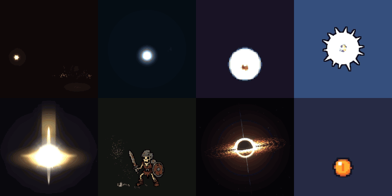
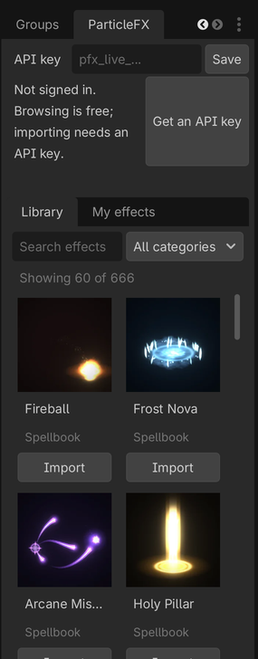

# ParticleFX Studio for Godot and Unity

Browse 650+ free game-ready 2D effects from [ParticleFX Studio](https://particlefx.studio)
inside your engine and import any of them with one click. Each import arrives
ready to drop into a scene: the sprite sheet sliced, the animation at the
effect's frame rate and loop setting, an additive material where the effect
glows, nearest filtering for pixel art, and the pivot at the effect's centre.



Effects are rendered on our server from the same engine as the website, so
what you import looks exactly like the preview. Make your own effects in the
[studio](https://particlefx.studio/studio) or describe one to the
[agent](https://particlefx.studio/agent), and they show up under **My effects**.

## Godot 4.2+



1. Install **ParticleFX Studio** from the Godot Asset Library (AssetLib tab),
   or copy `addons/particlefx` from this repository into your project's
   `addons/` folder.
2. Enable it in **Project > Project Settings > Plugins**.
3. Open the **ParticleFX** dock, paste an API key from
   [particlefx.studio/billing](https://particlefx.studio/billing) and press
   **Save**.
4. Search the library and press **Import**. The effect lands in
   `res://particlefx/<effect>/` as an `AnimatedSprite2D` scene that autoplays.

**Import zip...** also imports a bundle downloaded from the website, with no
account. Details: [addons/particlefx/README.md](addons/particlefx/README.md).

<br clear="right">

## Unity 2021.3+

1. Open **Window > Package Manager**, press **+** and choose
   **Add package from git URL...**
2. Paste:

   ```
   https://github.com/ParticleFX-Studio/particlefx-engine-plugins.git?path=/unity/com.particlefx.studio
   ```

3. Open **Window > ParticleFX Studio**, paste an API key from
   [particlefx.studio/billing](https://particlefx.studio/billing) and import.

Each import creates a prefab with a `SpriteRenderer`, an `Animator` playing the
effect, an additive material for glow effects (Built-in pipeline and URP) and a
`ParticleFXEffect` component with Play, Restart, Pause, Stop and a Finished
event. Details: [unity/com.particlefx.studio/README.md](unity/com.particlefx.studio/README.md).

## What is free

- Browsing the library needs no account.
- Importing free library effects at normal size needs a free account (an API
  key) and counts towards the daily free exports.
- Your own effects, FX pack effects, larger scales, normal maps for 2D lights
  and packed sheets come with a [plan](https://particlefx.studio/pricing).
- Imports never use AI builds.

Effects you export or import can be used in any game, including paid
commercial games, with no per-project licence.

## Privacy

The plugins talk only to the ParticleFX Studio API and fetch effect posters
from particlefx.studio. They send your API key, the effect you import and the
import options. Your key is stored in your editor settings on your machine,
never in the project, so it is not committed to version control.

## Links

- [ParticleFX Studio](https://particlefx.studio): the studio, the agent and the free effect library
- [Effect library](https://particlefx.studio/effects)
- [Unity guide](https://particlefx.studio/engines/unity) and [Godot guide](https://particlefx.studio/engines/godot)
- Bugs and requests: [GitHub issues](https://github.com/ParticleFX-Studio/particlefx-engine-plugins/issues)

## Licence

The plugin code is MIT licensed. See [LICENSE](LICENSE).
